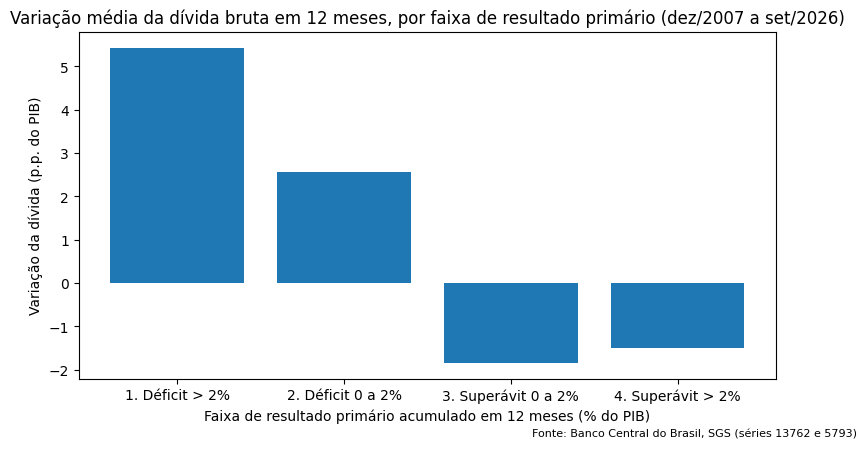
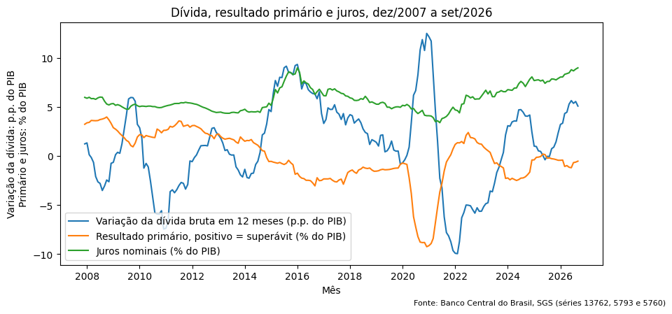

# A dívida só cresce quando há déficit primário?

Análise em **Python (pandas e matplotlib)** de 226 meses de dívida bruta, resultado primário e juros no Brasil, com dados abertos do Banco Central.

> **Resultado principal:** superávit primário não basta para a dívida cair. Entre dez/2007 e set/2026, a dívida bruta subiu em média **5,43 p.p. do PIB** em 12 meses nos meses de déficit primário acima de 2% e caiu **1,51 p.p.** nos de superávit acima de 2%. Mas, em **38 dos 104 meses com superávit**, ela subiu mesmo assim, porque o déficit nominal (juros − primário) foi positivo em todos os 226 meses.



## Pergunta

No debate público, a dívida costuma ser tratada como consequência direta do resultado primário. Só que o primário deixa de fora os juros, que continuam correndo mesmo nos anos de superávit. O trabalho testa se os dados sustentam a versão simples.

## Dados

Banco Central do Brasil, Sistema Gerenciador de Séries Temporais (SGS), lidos direto pela API de dados abertos:

| Série | Descrição | Unidade |
|---|---|---|
| 13762 | Dívida bruta do governo geral | % do PIB |
| 5793 | NFSP: resultado primário do setor público consolidado, 12 meses | % do PIB |
| 5760 | NFSP: juros nominais do setor público consolidado, 12 meses | % do PIB |

Período: dez/2006 a set/2026 (238 meses). A análise começa em dez/2007 (226 meses), porque o indicador compara cada mês com o mesmo mês do ano anterior.

## Método

1. Leitura das três séries pela API (`sep=";"`, `decimal=","`) e diagnóstico (tipos, nulos e duplicados).
2. Junção das séries numa única tabela (`dados.csv`). Daqui em diante a análise lê só esse arquivo, então dá pra reproduzir sem internet.
3. Inversão do sinal do primário, porque na NFSP positivo significa déficit.
4. Cálculo da variação da dívida em 12 meses e classificação de cada mês em quatro faixas de resultado primário.
5. Estatísticas descritivas por faixa (`groupby`), contagem de meses "superávit com dívida em alta" e correlações.

## Resultados

| Faixa de primário | Meses | Var. média (p.p.) | Mín. | Máx. | Déficit nominal médio |
|---|---:|---:|---:|---:|---:|
| Déficit > 2% | 48 | 5,43 | −3,25 | 12,50 | 9,84 |
| Déficit 0 a 2% | 74 | 2,57 | −8,14 | 9,34 | 7,52 |
| Superávit 0 a 2% | 52 | −1,84 | −9,95 | 5,97 | 3,77 |
| Superávit > 2% | 52 | −1,51 | −7,44 | 2,89 | 2,42 |

- A variação da dívida acompanha mais o **déficit nominal** (correlação 0,71) do que o primário (−0,65).
- Os meses de superávit com dívida em alta se concentram em **2009** e em **2012–2013**.



## Limitações

A análise é descritiva. Os meses se sobrepõem (janelas de 12 meses), as faixas se concentram em épocas diferentes e a base não traz crescimento do PIB, inflação nem câmbio, então não dá pra separar a contribuição de cada fator. O relatório completo detalha esses pontos.

## Como reproduzir

```bash
pip install -r requirements.txt
jupyter notebook analise.ipynb
```

## Arquivos

- `analise.ipynb`: notebook com todo o código, comentado.
- `dados.csv`: base tratada (238 linhas × 4 colunas).
- `relatorio.pdf`: relatório completo (7 páginas).
- `figuras/`: gráficos gerados pelo notebook.

## Autores

João Gabriel D'Aquino e Vinicius Nascimento: Programação para Economistas, Ciências Econômicas, Universidade Presbiteriana Mackenzie, 2026/2.

O uso de IA como ferramenta de apoio está declarado na seção 6 do relatório.
